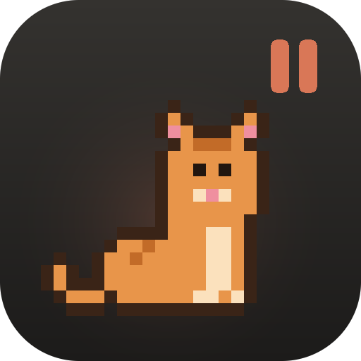

<p align="center"></p>

<h1 align="center">Idle Paws</h1>

<p align="center">A pixel pet that lives on your Claude Desktop window — and a menu of games for while Claude works.</p>

---

Waiting for Claude to finish a long task? **Idle Paws** puts a little pixel cat, dog or duck on top of
Claude's input bar. It walks, naps, plays fetch, hops when Claude finishes, and opens a menu of web games
in Claude's side browser pane so you have something to do in the meantime.

## Features

- **A pet on your input bar.** It finds Claude's message box and walks along the top of it, follows it
  when the box grows, and hides when a dialog covers it.
- **Three pets, several colours.** Cat, dog or duck; small, medium or large; chill, normal or zoomy.
- **Play with it.** Click for hearts, double-click to throw a ball (it fetches), drag it around, or switch
  to *Follow me* mode and it chases your cursor.
- **Games while you wait.** The pet's menu has a **🎮 Games** button that opens a games menu in Claude's
  side browser pane. It starts with a few picks; add any site you like or remove the ones you don't.
- **Ask Claude.** "Open game", "add murdoku.com to my games", "hide the pet", "list my games".
- **Reacts to Claude Code** *(optional)*: hops and says *Done!* when a session finishes, and shows a **!** when
  Claude needs your input.

## Requirements

- macOS 13 or later, on an Apple Silicon Mac (M1 or newer)
- [Claude Desktop](https://claude.ai/download)

## Install

1. Download **`idle-paws.mcpb`** from the [latest release](../../releases/latest).
2. Double-click it. Claude Desktop opens an install dialog. Click **Install**.
   - **Show games** is on by default; turn it off if you just want the pet.
3. macOS asks to let **Idle Paws** use **Accessibility**. Allow it: System Settings → Privacy & Security →
   Accessibility → Idle Paws.
   This lets the pet find Claude's input bar and lets **Games** open Claude's browser pane. Without it the
   pet still works, but sits near the bottom of the window instead.

The pet appears within a few seconds and starts and stops with Claude Desktop.

## Using it

| Do this | To |
|---|---|
| **Right-click** the pet | Open its menu: pet, colour, size, speed, mode, throw ball, hide, **🎮 Games** |
| **Double-click** the pet | Throw the ball |
| **Click** the pet | Pet it |
| **Drag** the pet | Move it |
| Double-click the 🐾 paw print | Bring a hidden pet back |

**Games:** click **🎮 Games** in the menu. Click a card to play, **+ Add game** to add any site (sites that
work on a phone fit the side pane best), or **×** on a card to remove it.

**Ask Claude:** in a Claude chat, try *"open game"*, *"add lichess.org/training to my games"*,
*"remove contexto"*, *"hide the pet"*.

### Optional: react when Claude Code finishes

The pet can hop and say *Done!* when a Claude Code session finishes. This uses Claude Code hooks.
Set it up from a clone of this repo:

```bash
node scripts/install-hooks.mjs          # turn on
node scripts/install-hooks.mjs --remove # turn off
```

It adds two hooks to `~/.claude/settings.json` (backed up first) and leaves your other hooks alone.

## Privacy

Everything runs on your Mac. Idle Paws has no accounts, no analytics and no servers of its own.

- The games menu is served locally (`localhost`); the games themselves are the websites you open.
- To show a picture on each game card, Idle Paws fetches that game's page once to read its preview image.
- The Accessibility permission covers only the Idle Paws app, not Claude.

## Uninstall

1. Claude Desktop → Settings → Extensions → **Idle Paws** → Uninstall.
2. If you set up Claude Code reactions: `node scripts/install-hooks.mjs --remove` (do this *before*
   uninstalling, or Claude Code will report a missing hook).
3. Optional: remove `~/Library/Application Support/idle-paws` and the Idle Paws entry under System Settings →
   Privacy & Security → Accessibility.

## Known limitations

- **macOS only, Apple Silicon only** for now.
- **Unsigned by Apple.** macOS may say the app is from an unidentified developer.
- **Depends on Claude's layout.** Idle Paws reads Claude's interface through Accessibility. A Claude Desktop
  update can change it; if the pet can't find the input bar it falls back to the bottom of the window, and if
  **Games** can't open the browser pane the pet tells you.
- Some sites can't be opened in Claude's built-in browser (for example NYT Games).

## Building from source

Needs Xcode Command Line Tools (Swift) and Node.js.

```bash
scripts/build.sh            # builds dist/IdlePaws.app and dist/idle-paws.mcpb
open dist/idle-paws.mcpb    # install into Claude Desktop
```

Logs go to `~/Library/Logs/idle-paws.log`.

## License

[MIT](LICENSE) © 2026 Pratyaksha Gupta

*Idle Paws is an independent project and is not affiliated with or endorsed by Anthropic. Claude is a
trademark of Anthropic.*
